# STAYCAST AI - Technical Report
*Intelligent Hotel Demand Forecasting & Decision Intelligence* - ALGIONS AI LABS PRIVATE LIMITED, AI & ML internship (Hotel Occupancy & Room-Demand Forecasting).

## 1. Executive summary
STAYCAST AI forecasts **daily net room-night demand by reserved room category for the next 1-14 days** from the public Hotel Booking Demand dataset. On a chronologically held-out test period (2017-05-11 to 2017-08-31) the selected model, **HistGradientBoosting**, reaches a WAPE of **3.0%** (7-day: 2.4%) against **10.7%** for a naive seasonal baseline. The model was chosen on validation data only (5.3% vs 19.0%).

Two honest qualifications: (1) about 93.7% of the model's reliance is on *bookings already on the books* at the forecast origin - without those features the same model scores 8.0% on test (baseline 10.7%); (2) the target is booking room-night demand, **not physical occupancy**, because the dataset contains no room inventory.

The system includes a leakage-safe feature pipeline, a saved joblib artifact, a FastAPI backend (real inference, validation, graceful errors), a seven-screen Streamlit dashboard and 61 automated tests.

## 2. Business problem
Managers need to anticipate room-night demand to plan staffing, housekeeping, room allocation and availability. The forecast supports human decisions; it never automates them.

## 3. Prediction target
`demand(d, c)` = number of booked room-nights on night *d*, for reserved room category *c*, from bookings that are **not cancelled** (1 booking = 1 room). Categories: A, D, E, F, G and Other (B, C, H, L, P pooled; each under 1% of bookings). Cancelled and no-show rows are kept in the data - they drive on-the-books features and the cancellation analysis - but are not counted in the target. Both hotels are pooled. **This is not occupancy**: no daily inventory exists, and no occupancy percentage is ever computed.

## 4. Forecasting horizon and prediction timestamp
The forecast origin is the **end of day t**; targets are t+1 ... t+14. 7-day results use horizons 1-7, 14-day results use 1-14. One model with horizon as a feature serves both.

## 5. Dataset source
Antonio, Almeida & Nunes (2019), *Hotel booking demand datasets*, Data in Brief 22, CC BY 4.0. Kaggle: jessemostipak/hotel-booking-demand. 119,390 rows x 32 columns; arrivals 2015-07-01 to 2017-08-31 (793 consecutive days).

## 6. Dataset limitations
- Bookings, not occupancy; no inventory, no room counts (1 booking = 1 room is assumed).
- Two Portuguese hotels, about two years: limited representativeness; only two summers (2016, 2017) plus Jul-Aug 2015.
- No booking ID: 31,994 exact duplicate rows (26.8%) cannot be proven to be the same booking.
- Booking dates are reconstructed as arrival minus lead time; cancellation date = `reservation_status_date`.
- Anonymised room-type codes; reserved type differs from assigned type for 12.5% of bookings.
- Arrivals end on 2017-08-31, so nights after that date are truncated and the file cannot support a true future forecast. All "latest forecasts" in the dashboard are **historical as-of forecasts**, not live ones.

## 7. Exploratory data analysis
Figures are in `reports/figures/eda_*.png` and in `notebooks/hotel_eda.ipynb`. Key findings (computed from the data):

- **Missing values.** `company` is missing for 94% and `agent` for 14% of bookings, so neither is used as a forecasting feature. Only 4 `children` and 488 `country` values are missing - harmless for a demand forecast.
- **Duplicates.** 31,994 rows (26.8%) are exact copies of another row. Dropping them lowers total room-nights to 86% of the keep-all level but the two daily series have correlation 0.942, so weekly/seasonal shape - what a forecaster learns - is unchanged. The absolute level may be understated if some copies are genuine repeat bookings (no booking ID exists to prove either way).
- **Cancellations.** 37.0% of bookings are cancelled - ignoring them would overstate demand by about a third. Cancellation climbs from 10% for last-minute bookings to 68% beyond a year of lead time, and 'Non Refund' deposits cancel at 99% (implausibly high, so it likely reflects how the source system recorded these bookings; deposit type is not used). This is why the model counts bookings 'on the books' at the origin only if not yet cancelled by then.
- **Weekday.** Sat is the busiest night and Sun the quietest; weekend nights average -2.2% versus weekdays. The weekday pattern is modest but consistent, which is exactly what the seasonal-naive baseline exploits.
- **Seasonality.** Month matters more than weekday: Jun-Aug averages 1.7x Dec-Feb, while the busiest weekday in a month is on average only 17% above the quietest. Calendar features therefore set the level, and recent history + bookings on the books supply the day-level detail.
- **Monthly trend.** Demand peaks in Jun and bottoms out in winter. Comparing Jan-Aug, 2017 averages +9.2% versus 2016 (2015 has July-December only), so there is a level shift on top of the seasonal cycle - a plain 'same as last year' rule would be biased.
- **Room categories.** Type A holds 72% of reservations. 12.5% of guests are placed in a different type from the one reserved, and assigned types I and K never appear as reservations - so assigned type is a check-in outcome. We forecast by RESERVED type and pool the rare types B, C, H, L, P into 'Other'.
- **Lead time.** Median lead time is 69 days but the mean is 104: a long right tail (max 737) of very early bookings. 43% of bookings are made more than 90 days ahead, which is what makes 'on-the-books' counts informative 7-14 days out.
- **ADR.** Price follows demand: mean ADR is highest in Aug (141) and lowest in Jan (72), with the Resort Hotel far more seasonal than the City Hotel. 1,959 raw rows have ADR = 0 and one has 5,400 (excluded from the chart tail); ADR is not a model feature because it is only observed with the booking, not forecastable demand.
- **Outliers.** Lead time, ADR and length of stay all have long right tails. ADR 5,400 and stays of 69 nights are extreme but still plausible bookings, so they are kept; they affect room-night counts by at most a handful of rows. Hard errors (zero nights, zero guests, negative ADR) are removed instead. See reports/cleaning_report.json.

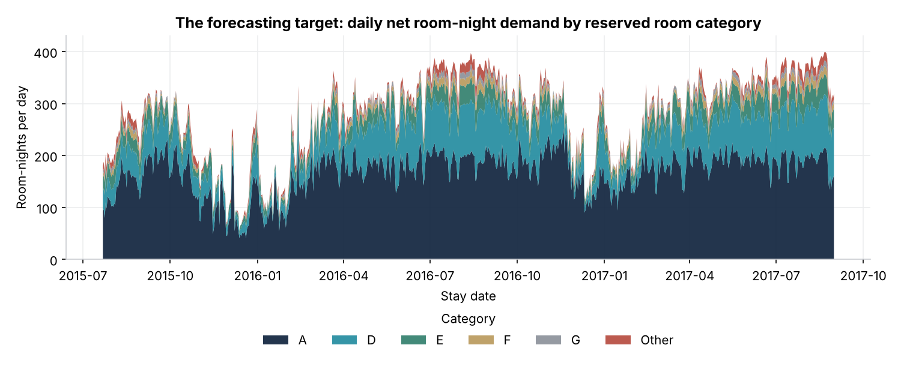

## 8. Preprocessing
Implemented in `src/preprocessing.py` (separate functions, raw file never modified, output `data/processed/bookings_clean.csv.gz`, decisions in `reports/cleaning_report.json`):
raw 119,390 rows -> exact duplicates dropped (31,994) -> invalid rows dropped sequentially (zero nights 651, zero guests 106, negative ADR 1) -> **86,638 clean bookings**. Type fixes: `children` NA -> 0, `country` NULL -> UNK, `agent`/`company` NULL -> NaN (unused). Consistency checks: no cancellation dated before booking or after arrival. After de-duplication the cancellation rate is 27.7% (37.0% raw).

## 9. Feature engineering
All features are computed by one class, `FeatureBuilder` (`src/feature_engineering.py`), used by both training and inference:
calendar of the target date (weekday, weekend, month, quarter, season, Portuguese public holiday via the `holidays` library); room category; horizon; demand lags 0-6 relative to the origin; same-weekday demand from the latest observed week(s); rolling means (7/14/28 days) and a 7/28 trend ratio; **on-the-books** room-nights for the target night at the origin (booked on/before t and not yet cancelled by t), their total across categories, the same quantity for the reference week and the resulting pace ratio; trailing 28-day cancellation rate and mean lead time of arrivals. The first usable origin is 2015-08-18 so every window is complete.

## 10. Leakage analysis (audit)
| Risk | Control |
|---|---|
| Demand after the origin in lags/rolling means | Lags are indexed from t; reference weeks use d - 7*ceil(h/7) <= t (tested for every row) |
| Bookings made after the origin | On-the-books counts only `booking_date <= t` |
| Future cancellations | A booking is removed only if `cancel_date <= t`; later cancellations are invisible at t |
| Outcome columns (`reservation_status`, `is_canceled` of future stays) | Not features; test asserts banned columns are absent |
| Assigned room type (known at check-in) | Not used; reserved type only |
| Random splitting | Chronological split by target date |
| Training/inference skew | Same `FeatureBuilder` for both |

**Executable proof:** `truncate_as_of(history, t)` rebuilds the booking history as known at the end of day t; `tests/test_forecasting.py` verifies that features for origin t are *identical* whether the full or the truncated history is used (four origins), and that distorting every booking made after t does not change any feature.

## 11. Baseline methodology
Naive seasonal: predict demand on the same weekday of the most recent fully observed week, d - 7*ceil(h/7) (one week back for h<=7, two for h 8-14). It uses no more information than the models and is evaluated on identical rows.

## 12. Model development
Candidates: Linear Regression (interpretable), Random Forest (nonlinear), HistGradientBoostingRegressor (nonlinear, efficient). Each was tried with and without a *residual target* (learning the correction to the baseline) and with a small hyper-parameter grid; selection used validation WAPE only. Seed 42 everywhere. Preprocessing (scaling for LR, one-hot for categoricals) is inside the saved pipeline. The search log is in `reports/metrics.json`.

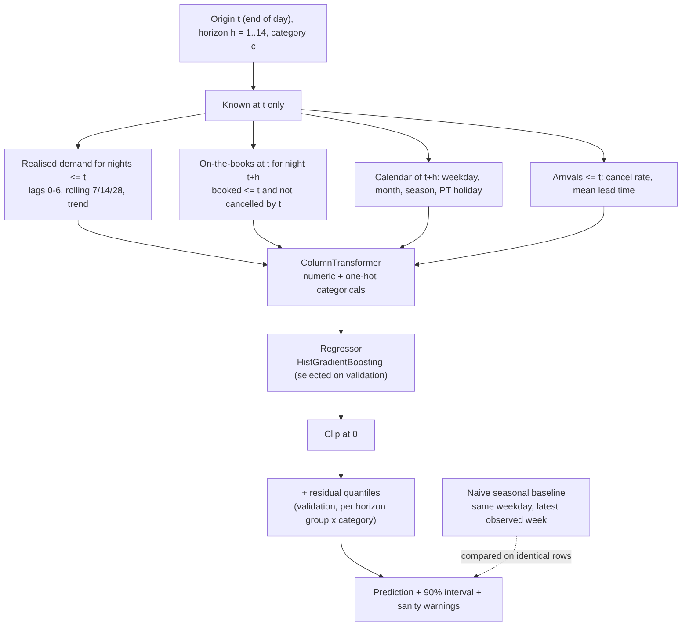

## 13. Chronological split
By target date: train 2015-08-19 to 2017-01-20 (43,218 rows), validation to 2017-05-11 (9,324), test to 2017-08-31 (9,408); roughly 70/15/15. Validation metrics come from train-only fits. After selection, the chosen configurations were **refitted on train+validation** and scored once on the untouched test period. Caveat: the test period is summer (high season) while validation is spring; both periods contain only one comparable season in training.

## 14. Evaluation results
| Model | Config chosen on validation | Val MAE | Val RMSE | Val WAPE | Test MAE | Test RMSE | Test WAPE |
|---|---|---|---|---|---|---|---|
| Naive seasonal baseline | same weekday, latest observed week | 9.181 | 15.392 | 19.0% | 6.31 | 11.625 | 10.7% |
| Linear Regression | residual target: False; defaults | 3.141 | 5.569 | 6.5% | 2.358 | 3.793 | 4.0% |
| Random Forest | residual target: False; {'n_estimators': 200, 'min_samples_leaf': 5, 'max_features': 0.5} | 2.769 | 5.706 | 5.7% | 1.892 | 3.363 | 3.2% |
| HistGradientBoosting (selected) | residual target: False; {'learning_rate': 0.05, 'max_iter': 300, 'max_leaf_nodes': 15, 'min_samples_leaf': 40, 'l2_regularization': 1.0} | 2.565 | 5.204 | 5.3% | 1.804 | 3.147 | 3.0% |

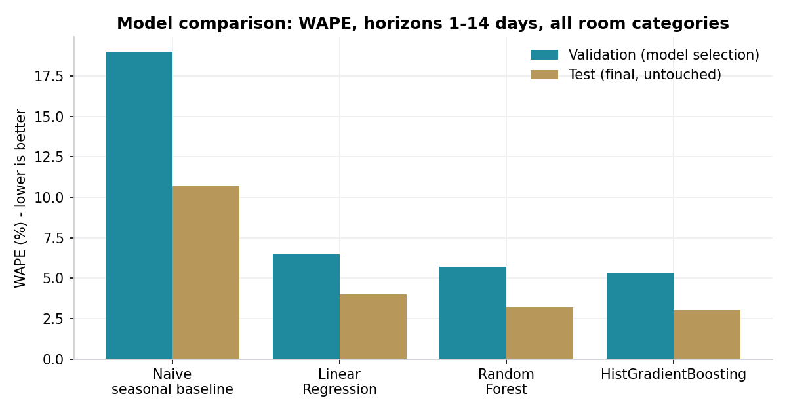
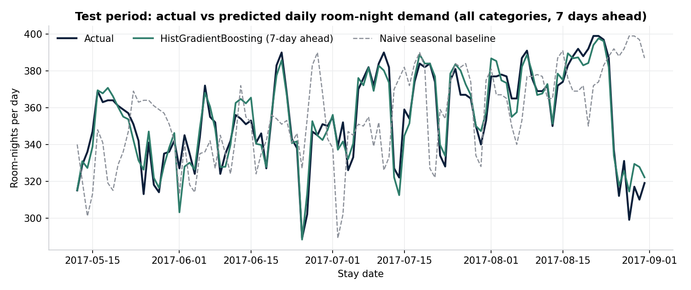

The selected model beats the baseline on both validation and test (3.0% vs 10.7%). Validation errors are higher than test errors for every model, **including the baseline** (baseline 19.0% vs 10.7%): the validation window (Jan-May 2017, with a moving Easter) is simply harder, so the gap should not be read as overfitting or luck in the test.

## 15. Error analysis
**By horizon (test)**

| Horizon (days) | Selected WAPE | Baseline WAPE |
|---|---|---|
| 1 | 1.6% | 10.4% |
| 3 | 2.3% | 10.4% |
| 5 | 2.7% | 10.4% |
| 7 | 3.1% | 10.4% |
| 10 | 3.6% | 10.9% |
| 14 | 4.1% | 10.9% |

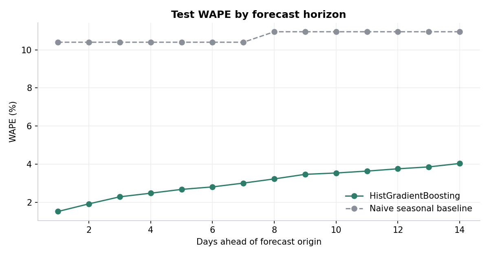

**By room category (test)**

| Category | Test MAE (room-nights/day) | Selected WAPE | Baseline WAPE |
|---|---|---|---|
| A | 4.861 | 2.5% | 10.2% |
| D | 2.503 | 2.7% | 7.5% |
| E | 1.262 | 3.5% | 10.6% |
| F | 0.718 | 5.2% | 16.6% |
| G | 0.703 | 7.6% | 22.7% |
| Other | 0.778 | 6.2% | 26.1% |

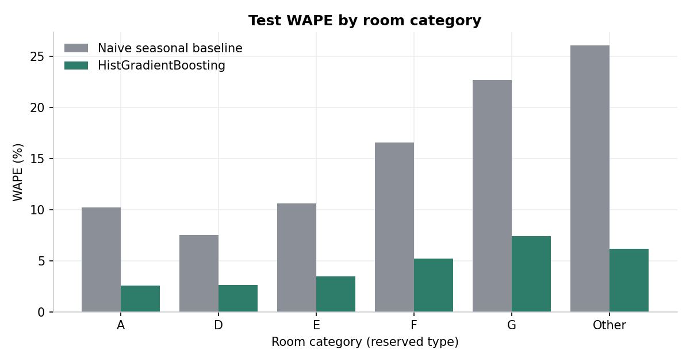
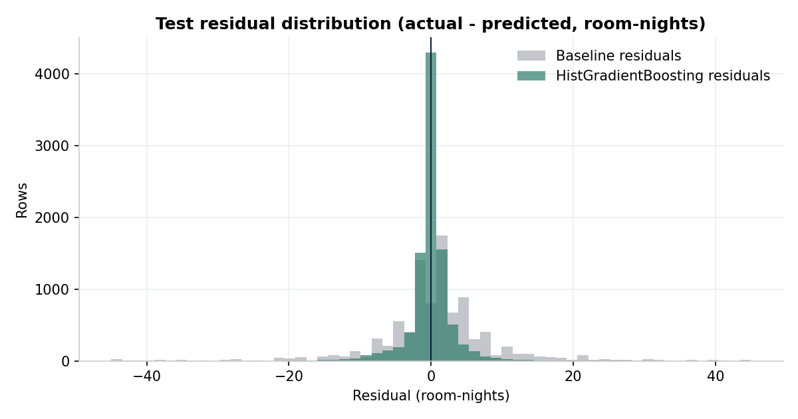

*What this means operationally.* For the large categories the average miss is a few room-nights per day (category A MAE 4.861), small relative to hundreds of room-nights - adequate for staffing and housekeeping rosters. For small categories (F, G, Other) the percentage error is larger because daily volumes are tiny, so allocation decisions for them should keep a manual buffer. Errors grow with horizon because fewer bookings are on the books.

## 16. Uncertainty and explainability
**Intervals.** Empirical quantiles of validation residuals per (horizon group x category) give a nominal 90.0% interval; observed test coverage was **93.0%** (mean width 10.65 room-nights). Slight over-coverage reflects the easier test period; coverage may be lower in unusual periods.

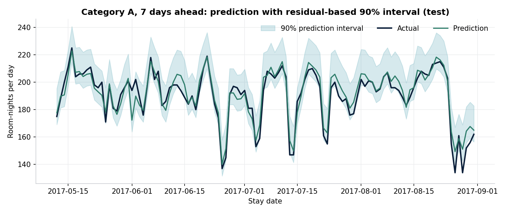

**Global importance** (grouped permutation importance on held-out validation rows):

| Feature group | MAE increase when shuffled | Share |
|---|---|---|
| On-the-books bookings (pickup) | 54.015 | 93.7% |
| Rolling averages & trend | 0.942 | 1.6% |
| Recent daily demand (lags) | 0.678 | 1.2% |
| Room category | 0.601 | 1.0% |
| Forecast horizon | 0.504 | 0.9% |
| Same-weekday history | 0.465 | 0.8% |
| Calendar (weekday, month, season) | 0.451 | 0.8% |
| Holiday calendar | 0.016 | 0.0% |
| Booking behaviour (cancel rate, lead time) | 0.002 | 0.0% |

**Ablation.** Removing the on-the-books group, the same model scores 16.5% (validation) and 8.0% (test) - still better than the baseline, but far worse than with pickup information. The headline accuracy therefore rests mostly on knowing what is already booked.

**Local explanations.** For each prediction the API reports, per feature group, how far the prediction moves if that group is replaced by a typical training value. These are sensitivities of the model, **not causal effects**.

**Sanity checks.** Output is clipped at zero; predictions are compared with the category's historical maximum; inputs outside training ranges are flagged; dates inside the training/validation period are marked in-sample.

## 17. Architecture
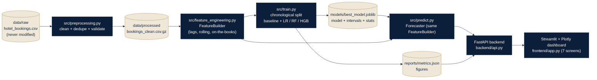

Modules: `src/` (data, preprocessing, features, models, train, evaluate, explainability, predict), `backend/` (FastAPI: api, schemas, services), `frontend/app.py` (Streamlit), `tests/`. The dashboard shows only API output; the API calls the saved model through `Forecaster`.

## 18. API instructions
`uvicorn backend.api:app --port 8000`, docs at `/docs`. Endpoints: `GET /api/health`, `/api/model/metrics`, `/api/model/info`, `/api/model/explain`, `/api/forecast`, `POST /api/forecast/predict`, `/api/forecast/history`, plus `/api/forecast/backtest`, `/api/overview`, `/api/analytics/categories`, `/api/data/health`. Invalid input returns 422 with a message; a missing or corrupt artifact returns 503 - no prediction is ever fabricated.

Example: `curl -X POST localhost:8000/api/forecast/predict -H "Content-Type: application/json" -d '{"target_date":"2017-08-25","room_category":"A","horizon":7}'`

## 19. Dashboard instructions
`streamlit run frontend/app.py` (API must be running; override with `STAYCAST_API_URL`). Screens: Executive Overview, Forecast Intelligence, Room Category Analytics, Model Performance Lab, Prediction Explorer, Explainable AI, Data & Model Health. Screenshots are in `reports/screenshots/`.

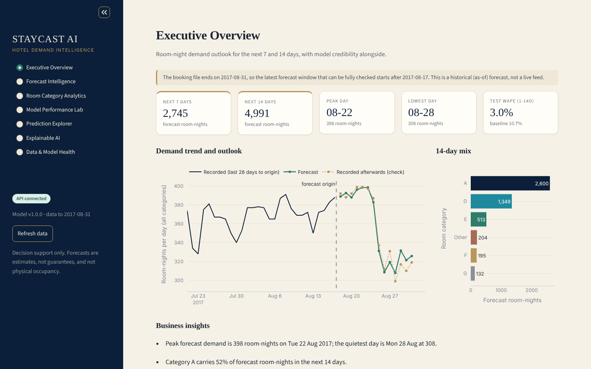
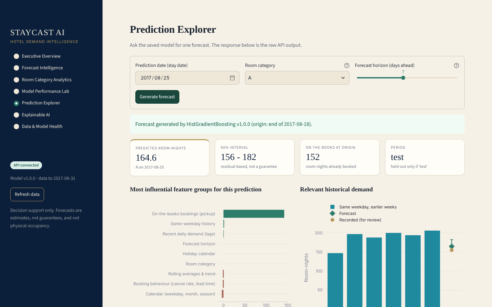

## 20. Testing
`pytest -q` runs 61 tests: schema/data validation, preprocessing, target expansion, leakage proofs, chronological split, determinism of training, artifact loading (missing, corrupt, incomplete), inference equals direct model output, invalid inputs, and every API endpoint including the 503 path.

## 21. Responsible AI
Decision support only; estimates are not guarantees; no personal data is used or shown (guest country is aggregated only in EDA); the model must not trigger automated high-stakes actions; in-sample dates and unusual inputs are flagged; limits are displayed in the Explainable AI screen.

## 22. Known limitations
Booking demand is not occupancy; short history with two summers; strong dependence on on-the-books data (a hotel without reliable booking-pace data would see the weaker ablation numbers); duplicates handled by a documented assumption; one booking = one room; intervals calibrated on one validation period; the dataset ends 2017-08-31 so no live forecast beyond it is possible; no drift monitoring is implemented.

## 23. Future improvements
Add real inventory to compute occupancy; expose booking-pace curves by lead-time bucket; quantile-regression or conformal intervals; rolling-origin cross-validation with more years; per-hotel models; event calendars; scheduled retraining with forecast-vs-actual monitoring; replace the Streamlit MVP with React if multi-user deployment is needed.
